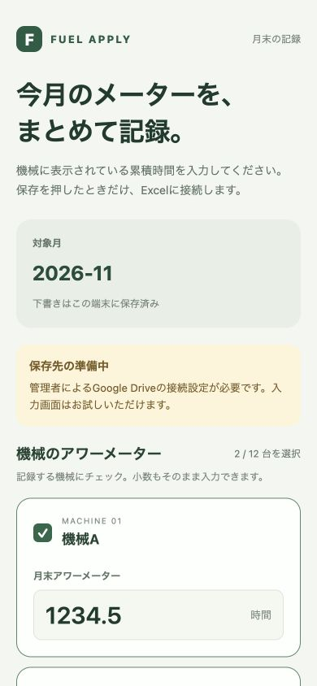
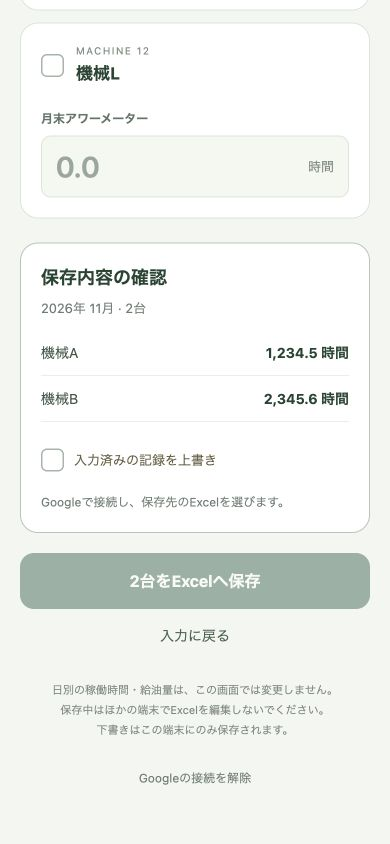

# Fuel Apply

農業機械の**月末アワーメーターをスマートフォンからまとめて記録**し、Google Drive上のExcel帳票へ転記するPWAです。12台分の入力を1回の保存で反映し、月末の転記作業を減らします。

利用者はURLを開くだけ。App Storeへの公開や、利用者側の開発環境は必要ありません。ホーム画面に追加すれば、アプリのように起動できます。

> 現在は接続設定前の実装です。ローカルの入力・下書き復元・確認画面、Excel実ファイルを使う転記テストを検証しています。Google認証と実Driveへの保存、実機のホーム画面起動は接続設定後に確認が必要です。

 

画面例は接続設定前のローカル版です。数値はサンプルです。

## 利用の流れ

1. 対象月を確認する。
2. 記録する機械の月末メーター値を入力する（例：`1234.5` 時間）。
3. 「入力内容を確認する」で、複数台の値をまとめて確認する。
4. 「Excelへ保存」を押し、Googleに接続して、対象月のExcelを選ぶ。
5. 保存完了を確認する。失敗した場合は入力を残し、再試行できる。

入力・機械選択・確認画面では、Google Driveへ接続しません。下書きは端末内に保存します。初回起動ではアプリ本体の読み込みが必要ですが、以降の入力はオフラインでも可能です。オンラインに戻っても自動送信はせず、利用者が保存を押します。

## Excelに合わせた仕様

付属の帳票は6台×2シートです。**月末の累積メーター値は42行目**へ記録します。日別の稼働時間と月末メーターは別の欄なので、月間の差を日別欄へ転記することはありません。

| 対象            | 前月末（確認のみ） | 月末（書き込み先） |
| --------------- | ------------------ | ------------------ |
| 各シートの1台目 | J7                 | J42                |
| 2台目           | M7                 | M42                |
| 3台目           | P7                 | P42                |
| 4台目           | S7                 | S42                |
| 5台目           | V7                 | V42                |
| 6台目           | Y7                 | Y42                |

- 前月末の値があれば、今回の値が下回っていないか確認します。空欄の場合は前回値を推測しません。
- 月末欄の既存値と異なる場合は、明示的な上書き指定が必要です。
- 帳票の対象月（A3）が空欄・`年　月`なら入力月を設定します。別の月が記載済みなら保存を止めます。
- 日別欄、前月末、給油量、合計欄は変更しません。このアプリだけで申請書全体の作成が完了するわけではありません。
- `.xlsx`をGoogleスプレッドシートへ変換せず、元のOOXMLパッケージ内の対象セルを更新します。書式、結合セル、画像、印刷設定などを維持します。

## 設計上の工夫

- **保存時だけ非同期通信**：Googleのライブラリ読み込み・認証・ファイル選択・取得・更新を保存操作から開始します。
- **少ない権限**：`drive.file`とGoogle Pickerを使用し、利用者が選択したファイルにアクセスします。
- **入力を失わない**：下書きを端末に保存し、通信失敗やキャンセル時も値を残します。
- **再試行に対応**：加算ではなく絶対値を転記します。反映済みなのに応答を受け取れなかった場合も、同じ値の再送で二重加算しません。
- **帳票の構造をテスト**：実際の12台用Excelで、対象セルだけが変わり、他のセル・結合・ZIP内の他ファイルが維持されることを検証します。

## コードの読み方

| ファイル                   | 責務                                                  |
| -------------------------- | ----------------------------------------------------- |
| `App.tsx`                  | 複数台の入力、確認、保存結果の表示                    |
| `src/records.ts`           | 月・メーター値・機械選択の検証、下書きの型            |
| `src/draft-storage.web.ts` | ブラウザ内の下書き保存                                |
| `src/auth.web.ts`          | 保存時のGoogle認証とExcel選択                         |
| `src/excel.ts`             | Driveから取得、更新前の版確認、ファイルのアップロード |
| `src/xlsx.ts`              | Excel内部の月末セルを変更する純粋関数                 |
| `src/config.ts`            | 接続・機械・セル設定の検証                            |
| `scripts/build-pwa.mjs`    | Web出力とオフライン用のアプリキャッシュ生成           |

画面、入力ルール、クラウド通信、Excel編集を分けています。最初に`records.ts`、次に`xlsx.ts`、最後に`excel.ts`を読むと、入力から転記までの流れを追えます。

## 開発者向け

Node.js 22.12以降（CIはNode 22）で実行します。以下は開発者用で、利用者のスマートフォンには不要です。

```bash
npm ci
npm run web
```

```bash
npm run typecheck
npm test
npm run build:web
npm run preview
```

`dist/`をHTTPSの静的ホスティングへ配置します。GitHub Pages向けには手動実行のワークフローも用意しています。React Native / Expoの画面をWebへ出力していますが、**このリリースの配布対象はPWA**です。ネイティブアプリのGoogle認証・配布は対象外です。

- [管理者の接続・配布手順](docs/setup.md)
- [利用者の使い方](docs/user-guide.md)
- [通信と保存の設計・制約](docs/architecture.md)

## 現在の制約

保存時にはExcelファイル全体を取得・再アップロードします（5MBまで、展開後40MBまで）。保存直前にDriveの版を再確認しますが、確認とアップロードの間をロックする仕組みではありません。**同じExcelを複数の端末やExcelアプリで同時に編集しない運用**にしてください。複数人による同時更新が必要になったら、サーバー側の保存制御を追加します。

マクロ付き・署名付き・暗号化されたファイル、Googleスプレッドシート形式は扱いません。実データ、トークン、OAuthクライアントシークレットはリポジトリへ含めません。
